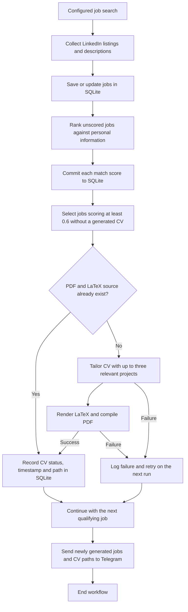

# Job finder

Collect LinkedIn jobs, rank them against your profile, and generate tailored
LaTeX CVs for matches scoring **0.6 or higher**. LangGraph coordinates the
workflow; Codex CLI handles ranking and tailoring through the shared LangChain
services using your ChatGPT subscription.

## Workflow



## Setup

Requires Python 3.14+, [uv](https://docs.astral.sh/uv/), and `pdflatex`.
On Debian/Ubuntu, install `texlive-latex-extra` and `lmodern` for PDF generation.

```bash
uv sync
cp .env.example .env
```

Install [Codex CLI](https://developers.openai.com/codex/cli), sign in with
ChatGPT for subscription access, and check the login:

```bash
npm install -g @openai/codex
codex login
codex login status
```

Optional settings in `.env`:

```dotenv
# CODEX_MODEL=your-supported-codex-model
# CODEX_TIMEOUT=30
# Optional; defaults to jobs.sqlite3 in the project root.
# DATABASE_URL=sqlite:///jobs.sqlite3
```

## Run

Edit your profile, header links and projects in
`src/job_finder/personal_info.py`. Configure the search in
`src/job_finder/main.py`, then run:

```bash
uv run alembic upgrade head
uv run job-finder
```

By default, the workflow uses `gpt-6.1-terra` with low reasoning effort. Choose
another model and, optionally, a reasoning level supported by that model:

```bash
uv run job-finder --model gpt-6.1-sol --reasoning-effort medium
```

`--model` takes precedence over `CODEX_MODEL` in the environment or `.env`.
The accepted models are `gpt-6.1-sol`, `gpt-6-astra`, `gpt-6.1-terra`,
`gpt-6-sol`, `gpt-6-luna`, `gpt-5.6-sol`, `gpt-5.6-terra`, and `gpt-5.6-luna`.
Availability depends on your Codex subscription.

The workflow collects jobs, stores them in SQLite, ranks unscored jobs, and
creates a PDF plus editable `.tex` source for qualifying matches. Each CV
includes up to three relevant projects with descriptions and technologies.
Your profile and job descriptions are sent to OpenAI through Codex CLI.
Requests force ChatGPT authentication and remove API-key environment variables;
they consume your subscription's Codex allowance and remain subject to its limits.
No API key is required. The adapter uses isolated temporary directories, read-only
sandboxing, ephemeral sessions and JSON Schema output validated with Pydantic.
It ignores user Codex configuration while retaining Codex's login store.
Set `CODEX_MODEL` to choose a model available to your subscription.

Files are saved under:

```text
generated_cvs/<company>_<job_name>_<short_hash>/
  abel_haro_armero_cv_<job_name>.pdf
  abel_haro_armero_cv_<job_name>.tex
```

Completed CVs are tracked in SQLite and skipped on later runs. Failed CVs are
retried next run. To regenerate, reset the job's `cv_generated`,
`cv_generated_at` and `cv_path` fields and remove its existing PDF/source pair.
Review generated CVs before submitting.

## Telegram notifications

Create a bot with [BotFather](https://t.me/BotFather), open a chat with your bot
and send `/start`. Find your chat's `message.chat.id` using the Bot API's
[getUpdates method](https://core.telegram.org/bots/api#getupdates), then set:

```dotenv
TELEGRAM_BOT_TOKEN=your-bot-token
TELEGRAM_CHAT_ID=your-chat-id
```

## Development

```bash
uvx ruff check .
uvx ruff format --check .
uv run python -m unittest discover -s tests -v
```
