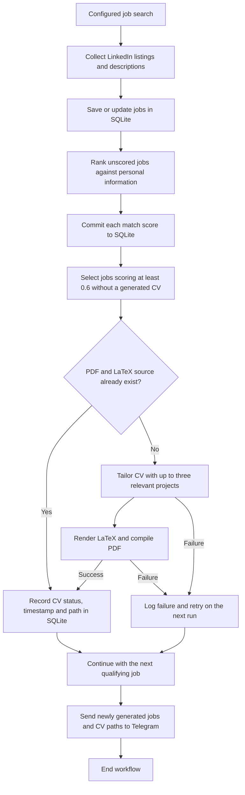

# Job finder

Collect LinkedIn jobs, rank them against your profile, and generate tailored
LaTeX CVs for matches scoring **0.6 or higher**. LangGraph coordinates the
workflow; Groq's `openai/gpt-oss-120b` handles ranking and tailoring.

## Workflow



## Setup

Requires Python 3.14+, [uv](https://docs.astral.sh/uv/), and `pdflatex`.
On Debian/Ubuntu, install `texlive-latex-extra` and `lmodern` for PDF generation.

```bash
uv sync
cp .env.example .env
```

Add your Groq key to `.env`:

```dotenv
GROQ_API_KEY=your-key
# Optional; defaults to jobs.sqlite3 in the project root.
# DATABASE_URL=sqlite:///jobs.sqlite3
```

## Run

Edit your profile, header links and projects in
`src/job_finder/personal_info.py`. Configure the search in
`src/job_finder/main.py`, then run:

```bash
uv run alembic upgrade head
uv run job-finder
```

The workflow collects jobs, stores them in SQLite, ranks unscored jobs, and
creates a PDF plus editable `.tex` source for qualifying matches. Each CV
includes up to three relevant projects with descriptions and technologies.
Your profile and job descriptions are sent to Groq.

Files are saved under:

```text
generated_cvs/<company>_<job_name>_<short_hash>/
  abel_haro_armero_cv_<job_name>.pdf
  abel_haro_armero_cv_<job_name>.tex
```

Completed CVs are tracked in SQLite and skipped on later runs. Failed CVs are
retried next run. To regenerate, reset the job's `cv_generated`,
`cv_generated_at` and `cv_path` fields and remove its existing PDF/source pair.
Review generated CVs before submitting.

## Telegram notifications

Create a bot with [BotFather](https://t.me/BotFather), open a chat with your bot
and send `/start`. Find your chat's `message.chat.id` using the Bot API's
[getUpdates method](https://core.telegram.org/bots/api#getupdates), then set:

```dotenv
TELEGRAM_BOT_TOKEN=your-bot-token
TELEGRAM_CHAT_ID=your-chat-id
```

## Development

```bash
uvx ruff check .
uvx ruff format --check .
uv run python -m unittest discover -s tests -v
```
